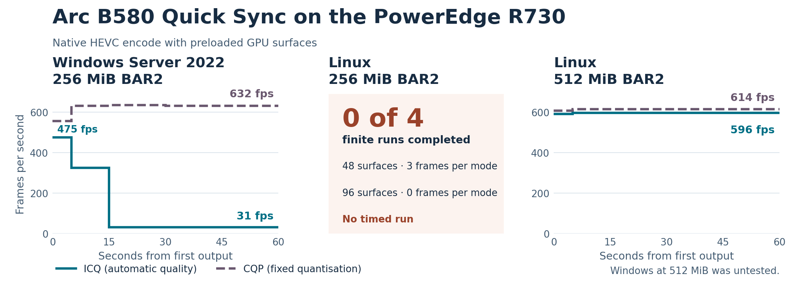

# Intel Arc B580 Quick Sync slowdown on a Dell PowerEdge R730

Public report draft v0.2 · 6 November 2026 · Case ARC-R730-001

## Plain-English summary

We put an Intel Arc B580 in a Dell PowerEdge R730 to handle video encoding and HDR transcoding. The card could start an encode quickly under Windows Server 2022, then slow sharply partway through. We reduced that behaviour to a test that sends the same 1080p frames directly to the hardware encoder. With Intel’s automatic quality mode (ICQ), a run fell from about 475 to 31 frames per second. With fixed quantisation (CQP), the same setup held about 632 frames per second. The ICQ slowdown also occurred on the same machine under a Windows 11-based Microsoft Validation OS image. Replacing Server 2022 alone would therefore have been an uncertain fix.

The R730 firmware gave the GPU a 256 MiB PCIe memory window. This window, called a BAR aperture, controls how much of the GPU’s memory address space the CPU can see at once. The card still has 12 GiB of physical video memory. Linux could run a smaller encoding test at 256 MiB after a media-driver fix. Our more demanding test, which kept dozens of uncompressed frames ready on the GPU, failed at that size. We expanded the PCIe bridge window for the GPU branch in Linux, then had Linux move and resize the GPU aperture. At 512 MiB, both modes passed and sustained about 596 and 614 frames per second. They held essentially the same speeds at every tested size through 16 GiB.

*Figure 1. Horizontal steps show averages for measured time intervals. The centre panel reports the finite native test at 256 MiB. A separate Linux rolling-pool workload did encode at that size. The right panel shows Linux recovery after the bridge window and BAR were changed. Windows at 512 MiB was untested. [Test methods and results](appendix-a-tests.md)*

The final working configuration was a Debian 13 USB installation that set the aperture to 16 GiB during boot. It completed the 90-second tests at about 598 fps in ICQ and 615 fps in CQP. We installed and booted one kernel update on the R730, verified that the aperture was still 16 GiB, and repeated the short encode and pixel checks successfully. This provides a working Linux path for this hardware.

We also built a UEFI USB application that successfully handed off to Windows Boot Manager. Windows came up with the original 256 MiB window. The firmware had already assigned the PCIe resources and we found no verified way for our late-loading application to reallocate just the GPU branch. A 512 MiB Windows test would help determine whether the Linux recovery carries over to Windows. That test remains open.

## What the experiments establish

| Question | Finding |
| --- | --- |
| Is the controlled Windows failure dependent on Server 2022? | No. It reproduced on Windows 11-based Validation OS on the same R730, B580 and 256 MiB aperture. Windows build or driver interactions remain possible. A full retail Windows 11 installation was outside this comparison. |
| Does the hardware encoder always slow down on Windows? | HEVC CQP sustained about 631–633 fps in the matched Windows tests. ICQ slowed on both Windows environments. Windows AV1 showed a different pattern in which CQP also declined. |
| Does Linux need 512 MiB for every encode? | The FFmpeg rolling-pool workload ran at 256 MiB. The separate native 48/96-surface resident-input workload first passed at 512 MiB. These are results for the tested software and settings. |
| Is 16 GiB faster than 512 MiB? | The six passing sizes were essentially flat for the resident-input test. The 16 GiB setting qualified for the portable Debian boot workflow. |
| Does the work establish that the small BAR caused Windows ICQ to slow down? | The Linux size transition makes aperture pressure or allocation geometry a priority lead. Windows at a verified larger BAR, and the private driver state at the transition, remain unmeasured. |

Intel's desktop guide lists Windows 10/11 and Ubuntu for the Arc B-series and calls for Resizable BAR for optimal performance. This R730 with its stock small aperture and Server 2022 falls outside that published platform guidance. The Debian results are field measurements on one machine. [Intel Arc desktop quick-start guide](https://www.intel.com/content/www/us/en/support/articles/000091128/graphics/intel-arc-dedicated-graphics-family.html)

## How the diagnosis narrowed

1. **Application to encoder.** The original report involved FastFlix/QSVEnc and HandBrake on Arc A380 and B580. The controlled B580 test eliminated Plex, compressed decode, filtering, resizing, tone mapping and media storage. We measured completed output and decoded every completed frame in the core comparisons.
2. **General GPU load to rate-control path.** A separate compute load could sustain high clock and power. Clock policy and CPU-affinity controls did not restore the slow encode. Real D3D11 video surfaces improved the slow-state floor, while HEVC CQP remained fast. A hardware clock drop accompanied the failure in some observations. Its direction of causation remains unresolved.
3. **Windows version and storage.** The same synthetic comparison reproduced on Validation OS with input preloaded and output to a checked RAM disk. This separates the finding from the production Server 2022 install and its output disk.
4. **Driver-side evidence.** Public Windows graphics traces showed copy-context waits and more small-allocation evictions during the ICQ slow phase. The API continued to report video-memory input and no external input locks. The traces localise waiting but do not expose the driver's initiating decision or private placement.
5. **Linux allocation and boot.** We separately fixed small-aperture media allocation, PCIe parent-window capacity and render-node discovery. A same-boot ascending Linux sweep showed the resident-input test recover at 512 MiB. A persistent Debian USB then verified 16 GiB after Xe binding and after one kernel update.
6. **Windows handover.** An unchanged-resource UEFI handoff succeeded. Firmware inspection and saved resource maps explained why the tested late reconnect route was insufficient to make a larger allocation. No resized Windows benchmark was obtained.

## The comparison most likely to resolve the Windows question

Run the same hardware, Windows image, driver payload, native test, synthetic input and verification at a freshly confirmed 256 MiB and a freshly confirmed 512 MiB or larger. Keep a validated allocation route and record the post-start Windows resource descriptor, ancestor coverage and observed BAR length. Compare both rate-control modes, repeat each setting and reverse the order where possible. Capture fast CQP and slow ICQ traces under the same instrumentation with loss accounting. A supported modern Windows/ReBAR platform would also establish a reference, while changing several hardware variables at once.

A question for Intel media and driver engineers is which private telemetry can distinguish ICQ control processing from WDDM residency or aperture contention when a preloaded video-input workload slows down. The trace signatures and exact fixture details are in [Appendix A](appendix-a-tests.md).

## Technical material

- [Appendix A · Platform, methodology, results and causal evidence](appendix-a-tests.md)
- [Appendix B · Linux corrective steps, boot validation and UEFI allocation limits](appendix-b-pci-boot.md)
- [Appendix C · Upstream references, tool inventory and release rights](appendix-c-sources-and-licences.md)
- [Machine-readable results and schema](data/README.md)

The report includes case trial IDs so the findings can be mapped to preserved records. The distributable draft contains selected measurements and configuration details. It contains no raw machine logs, media, operating-system images, firmware, tool binaries or third-party source.

## Licence

The original report, figure and derived test data are available under the [Creative Commons Attribution 4.0 International licence](LICENSE). Suggested credit is **ARC-R730-001 contributors**, with a link to this repository and the licence. Third-party materials and referenced projects retain their own terms.
